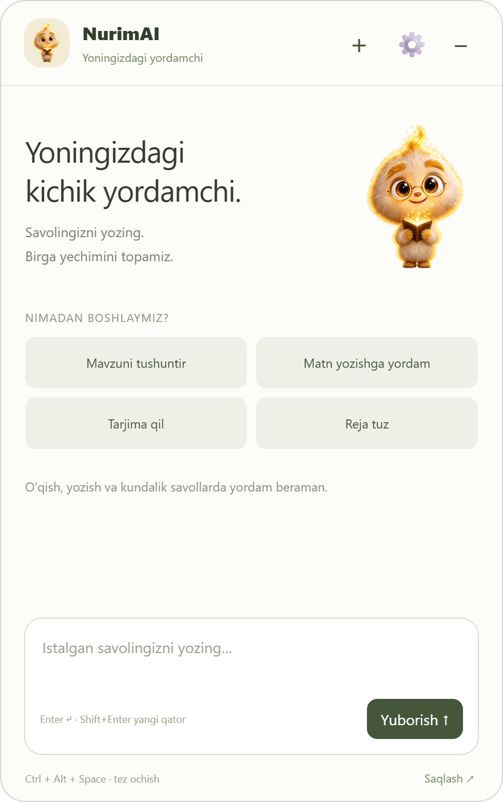
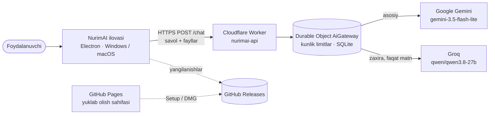

<p align="center"></p>

<h1 align="center">NurimAI — loyiha haqida</h1>

<p align="center">Windows, Mac, Android va iPhone uchun bepul, o‘zbek tilidagi kichik AI yordamchi.<br>
<a href="https://ux7umid7.github.io/NurimAI/">Yuklab olish sahifasi</a> · <a href="https://github.com/Ux7umid7/NurimAI/releases/latest">So‘nggi reliz</a> · Joriy versiya: <b>0.7.1</b></p>

---

## Mundarija

1. [Umumiy ko‘rinish](#1-umumiy-korinish)
2. [NurimAI nima uchun kerak](#2-nurimai-nima-uchun-kerak)
3. [Qaysi texnologiyalar bilan yaratilgan](#3-qaysi-texnologiyalar-bilan-yaratilgan)
4. [Qaysi platformalarda ishlaydi (backend, API)](#4-qaysi-platformalarda-ishlaydi-backend-api)
5. [Qaysi AI modellaridan foydalanadi](#5-qaysi-ai-modellaridan-foydalanadi)
6. [Qo‘shimcha ma’lumotlar](#6-qoshimcha-malumotlar)

---

## 1. Umumiy ko‘rinish

NurimAI — kompyuter ekranining chetida turadigan kichik qahramon. Uni bossangiz chat oynasi ochiladi: savol yozasiz yoki skrinshot, rasm, PDF, Word, Excel, PowerPoint faylini berasiz, NurimAI esa o‘zbek tilida tushuntiradi, tarjima qiladi, xatoni topadi, matn va reja tuzishga yordam beradi.

<p align="center"></p>

**Asosiy imkoniyatlar**

- 💬 **Chat** — istalgan savol, mavzuni tushuntirish, matn yozish, tarjima, reja tuzish.
- 📎 **Fayllar** — rasm, skrinshot, PDF, Word (.docx), Excel (.xlsx), PowerPoint (.pptx), matn va CSV. Faylni tugma, sudrab tashlash yoki `Ctrl+V` bilan berish mumkin.
- 🖥️ **Ekranni suratga olish** — bitta tugma ekranni rasmga olib, savolga qo‘shadi. NurimAI o‘z oynasini rasmga tushirmaydi.
- ⚡ **Tezkor tugmalar** — fayl uchun: qisqacha mazmun, tushuntirish, tarjima, xatolarni topish, test savollari tuzish.
- 🧸 **3D qahramon** — momiq, tutami nur sochadi. Ekran chetida nafas oladi va ko‘z qisadi, salom beradi, javob tayyorlanayotganda o‘ylaydi, javob kelganda quvonib sakraydi, uzoq kutsangiz uxlab qoladi, xato bo‘lsa xafa bo‘ladi, fayl bersangiz uni ilib oladi.
- ✨ **Belgilangan matnni tushuntirish** — istalgan dasturda matnni belgilab `Ctrl+Alt+E` (Mac’da `⌘+⌥+E`) bosiladi, NurimAI uni oddiy tilda tushuntiradi.
- 🎤 **Ovozli savol va javob** — mikrofon tugmasi bilan savol beriladi, NurimAI eshitganini yozib javob beradi; javobni 🔊 bilan o‘zbekcha ovozda tinglash mumkin (Gemini TTS).
- 🎓 **Ustoz rejimi** — mavzu yoki suhbat bo‘yicha test (har javobga izoh), yodlash kartochkalari (Leitner takrorlash jadvali), kunlik mashq seriyasi 🔥, eslatmalar; xato javoblar o‘zi kartochkaga aylanadi. “Ustoz uslubi” yoqilsa, javob qadamma-qadam o‘rgatiladi.
- 📱 **Telefon versiyasi** — Android ilova (APK) va iPhone uchun veb-ilova (“Bosh ekranga qo‘shish”): chat, kamera, fayllar, ovoz, Ustoz va tarix telefonda ham.
- 🕘 **Suhbatlar tarixi** — eski suhbatlarni qidirish, ochib davom ettirish va o‘chirish; faqat shu kompyuterda, shifrlangan holda.
- 📌 **Har doim yonida** — qahramonni ekranning istalgan chetiga sudrab qo‘yish mumkin, `Ctrl+Alt+Space` (Mac’da `⌘+⌥+Space`) chatni istalgan dasturdan ochadi.
- 🔄 **O‘zi yangilanadi** — Windows’da yangi versiya fonda yuklanadi va dasturdan chiqqanda o‘rnatiladi.
- 🆓 **Bepul** — ro‘yxatdan o‘tish, to‘lov va API kalit kerak emas.

| | |
|---|---|
| Platformalar | Windows 10/11 (64-bit), macOS (Apple Silicon va Intel), Android 7+ (APK), iPhone va boshqa telefonlar (veb-ilova) |
| Til | O‘zbek (lotin), foydalanuvchi boshqa tilda yozsa — o‘sha tilda |
| Narx | Bepul, umumiy kunlik limit bilan |
| Joriy versiya | 0.7.1 (2026-yil 24-oktabr) |

---

## 2. NurimAI nima uchun kerak

Ko‘p AI xizmatlari ingliz tilida ishlaydi, ro‘yxatdan o‘tish, karta yoki API kalit talab qiladi va brauzerda alohida sahifada ochiladi. O‘quvchi yoki ustoz uchun bu ortiqcha qadamlar. NurimAI shu to‘siqlarni olib tashlaydi:

| Muammo | NurimAI’da |
|---|---|
| Javoblar ingliz tilida yoki g‘alati tarjimada | Odatda o‘zbek lotin yozuvida, sodda va qisqa javob beradi |
| Hisob ochish, to‘lov, API kalit kerak | Hech narsa kerak emas: o‘rnatasiz va yozasiz |
| AI’ga borish uchun brauzer va tab almashtirish kerak | Qahramon doim ekranda, bitta bosish yoki tugmalar birikmasi yetarli |
| Uy vazifasi rasmda, darslik PDF’da, jadval Excel’da | Faylni o‘zini beraverasiz, NurimAI o‘qib tushuntiradi |
| Shaxsiy ma’lumotlar haqida xavotir | Server suhbatni saqlamaydi, dastur faqat siz bergan faylni ko‘radi |

**Kimlar uchun:** o‘quvchilar va talabalar (uy vazifasi, mavzuni tushunish, test tayyorlash), ustozlar (dars rejasi, test savollari, matnni tekshirish), ofis xodimlari (xat yozish, tarjima, Excel jadvalni tushuntirish).

**Misollar**

- “Shu masalani tushuntirib ber” — skrinshot bilan.
- “Bu PDF bobining qisqacha mazmunini yoz.”
- “Referatimdagi xatolarni top” — Word fayl bilan.
- “Shu jadval bo‘yicha qaysi oy eng yaxshi bo‘lgan?” — Excel fayl bilan.
- “Shu mavzu bo‘yicha javoblari bilan 5 ta test tuz.”

---

## 3. Qaysi texnologiyalar bilan yaratilgan

| Qism | Texnologiya | Versiya | Vazifasi |
|---|---|---|---|
| Desktop ilova | [Electron](https://www.electronjs.org/) (Chromium + Node.js) | 44.9.0 | Windows va Mac uchun bitta kod bazasi |
| Telefon ilovasi | Veb-ilova (PWA, `docs/app`) + [Capacitor](https://capacitorjs.com/) Android | Capacitor 8.5.3 | iPhone’da Safari orqali, Android’da APK; test, ovoz va fayl mantiqi desktop bilan umumiy (`src/shared`) |
| Interfeys | Oddiy HTML, CSS, JavaScript (freymvorksiz) | — | Chat oynasi, qahramon, sozlamalar |
| O‘rnatuvchi | electron-builder | 26.15.3 | Windows NSIS Setup, Mac universal DMG/ZIP |
| Avtoyangilanish | electron-updater + GitHub Releases | 6.8.9 | Yangi versiyani topish, yuklash, o‘rnatish |
| Server | Cloudflare Workers + Durable Objects (SQLite) | Wrangler 4.151.1 | AI’ga so‘rov yuborish, kunlik limitlar |
| Fayllarni o‘qish | O‘zimizning ZIP o‘quvchi (Node.js `zlib`) | — | Word/Excel/PowerPoint’dan matn ajratish, tashqi kutubxonasiz |
| Testlar | `node:test` va Playwright (Electron) | Node 24, Playwright 1.64.1 | 71 ta unit va 17 ta UI test (4 tasi telefon ilovasi uchun) |
| CI/CD | GitHub Actions | — | Har push’da Windows va macOS’da test va build, teg bo‘yicha reliz |
| Sayt | GitHub Pages, oddiy HTML/CSS/JS | — | Yuklab olish sahifasi, yangilash ko‘rsatmasi |
| 3D qahramon | Blender 5.1 (Cycles, Geometry Nodes jun) → shaffof WebM (VP9 + alfa) | — | 9 ta animatsiya: kutish, o‘ylash, quvonish, salom, uyqu, xafa bo‘lish, faylni ilib olish, gapirish, tinglash; og‘iz holati shader bilan boshqariladi |
| Ikonkalar | SVG manba → `npm run icons` | — | `.ico`, Mac ikonkasi, menyu paneli belgisi, sayt rasmlari |

**Arxitektura**



**Loyiha tuzilmasi**

```text
NurimAI-Desktop/
├── src/                  Electron ilovasi
│   ├── main.cjs          Asosiy jarayon: oynalar, tray, IPC, fayl biriktirish, ekranni olish
│   ├── preload.cjs       Interfeysga ochiladigan xavfsiz API
│   ├── index.html, renderer.js, style.css   Chat oynasi
│   ├── pet.html, pet.js, pet.css            Ekran chetidagi qahramon
│   ├── router.cjs        AI xizmatlariga so‘rov va almashish (Gemini → Groq)
│   ├── gateway.cjs       NurimAI serveriga ulanish
│   ├── attachments.cjs   Fayllarni tayyorlash (Word/Excel/PowerPoint/PDF/rasm)
│   ├── store.cjs         Sozlamalar va shifrlangan shaxsiy kalitlar
│   ├── chats.cjs         Suhbatlar tarixi (shifrlangan, qidiruv bilan)
│   ├── selection.cjs     Belgilangan matnni olish (Ctrl+Alt+E), buferni tiklash
│   ├── practice.cjs      Ustoz rejimi: testlar, kartochkalar, seriya, eslatmalar
│   ├── shared/           Telefon ilovasi bilan umumiy mantiq (test/kartochka, Office fayllar)
│   ├── voice.js, ustoz.js Ovoz yozish/tinglash va Ustoz paneli
│   ├── updater.cjs       Avtoyangilanish boshqaruvi
│   └── whats-new.json    “Nima yangi” matnlari
├── server/               Cloudflare Worker (worker.mjs, wrangler.jsonc)
├── docs/                 GitHub Pages sayti; docs/app/ — telefon veb-ilovasi
├── mobile/               Capacitor Android loyihasi (APK)
├── assets/               Ikonkalar, qahramon rasmi, nur/ — 3D animatsiyalar (idle, think, happy, wave, sleep, sad, catch, talk, listen)
├── scripts/              Reliz va ikonka skriptlari
├── tests/                Unit va UI testlar
└── .github/workflows/    CI/CD
```

---

## 4. Qaysi platformalarda ishlaydi (backend, API)

### Foydalanuvchi kompyuteri

| Platforma | Paket | O‘rnatish | Yangilanish |
|---|---|---|---|
| Windows 10/11, 64-bit | `NurimAI-Windows-Setup.exe` (NSIS) | Bir bosishda, administrator huquqisiz | Avtomatik |
| Android 7+ | `NurimAI-Android.apk` (Capacitor) | APK’ni ochib “noma’lum manbaga ruxsat” | Qo‘lda (yangi APK) |
| iPhone va boshqa telefonlar | Veb-ilova: https://ux7umid7.github.io/NurimAI/app/ | Safari → Ulashish → Bosh ekranga qo‘shish | Avtomatik (sahifa yangilanadi) |
| macOS, Apple Silicon va Intel | `NurimAI-Mac.dmg` (universal) | Applications’ga sudrab tashlash | Qo‘lda (Apple Developer ID imzosi yo‘q) |

### Backend: Cloudflare Workers

| | |
|---|---|
| Xizmat | Cloudflare Workers (Free tarif) |
| Worker nomi | `nurimai-api` (`https://nurimai-api.<hisob>.workers.dev`) |
| Holat saqlash | Durable Object `AiGateway`, SQLite — umumiy kunlik budjet va limitlar |
| Maxfiy kalitlar | `GEMINI_API_KEY`, `GROQ_API_KEY`, `RATE_SALT` — faqat Cloudflare Secrets’da |
| Jurnallar | Cloudflare observability o‘chirilgan; xato bo‘lsa faqat AI xizmatining HTTP kodi `wrangler tail`da ko‘rinadi |

API kalitlari hech qachon ilovaga, GitHub’ga yoki o‘rnatish paketiga tushmaydi. Ilova faqat server manzilini biladi.

### API

**`GET /health`** — server tayyorligi: `{"service":"NurimAI","ready":true}`. Kalit yoki hisob haqida ma’lumot bermaydi.

**`POST /speak`** (0.6.1 dan) — javob matnini ovozga aylantirish: `{"deviceId": "…", "text": "1–1200 belgi"}` → `{"mime": "audio/wav", "audio": "base64…"}`. Alohida kunlik limit (qurilmaga 40, jami 400), chat limitini kamaytirmaydi.

**`POST /chat`** — savol yuborish. `Content-Type: application/json`, brauzerdan (`Origin` sarlavhasi bilan) kelgan so‘rovlar rad etiladi.

```json
{
  "deviceId": "tasodifiy UUID",
  "question": "1–6000 belgi",
  "history": [{ "role": "user", "text": "…" }, { "role": "assistant", "text": "…" }],
  "files": [
    { "kind": "text", "name": "referat.docx", "text": "fayldan ajratilgan matn" },
    { "kind": "image", "name": "skrinshot.png", "mime": "image/png", "data": "base64…" },
    { "kind": "pdf", "name": "kitob.pdf", "mime": "application/pdf", "data": "base64…" },
    { "kind": "audio", "name": "Ovozli savol.wav", "mime": "audio/wav", "data": "base64…" }
  ]
}
```

Javob: `{"text": "…", "incomplete": false}`. `files` maydoni ixtiyoriy (0.4.0 dan), shuning uchun eski 0.3.0 ilovalar ham ishlayveradi.

| Kod | Ma’nosi |
|---|---|
| 200 | Javob tayyor |
| 400 | So‘rov noto‘g‘ri (maydon, fayl turi yoki hajmi) |
| 403 | Brauzerdan kelgan yoki manzili aniqlanmagan so‘rov |
| 413 | So‘rov 14 MB dan katta |
| 422 | AI savol yoki faylni qabul qilmadi |
| 429 | Kunlik yoki daqiqalik limit tugadi (`Retry-After` bilan) |
| 503 | AI xizmatlari vaqtincha javob bermayapti |

### Limitlar

| Limit | Qiymat |
|---|---|
| Hamma foydalanuvchilar uchun jami | 200 so‘rov/kun |
| Bitta qurilmadan | 30 so‘rov/kun |
| Bitta IP manzildan | 60 so‘rov/kun va 4 so‘rov/daqiqa |
| Bir vaqtda ishlov beriladigan so‘rovlar | 4 ta |
| Suhbatdagi fayllar | 5 tagacha |
| PDF | 7 MB gacha |
| Rasm | 2000 px gacha kichraytiriladi, siqilgandan keyin 4 MB gacha |
| Hujjat matni | Bitta faylda 60 000, jami 120 000 belgigacha |

Limitlar `server/wrangler.jsonc` dagi `DAILY_TOTAL`, `DAILY_DEVICE`, `DAILY_IP` bilan o‘zgartiriladi. IP va qurilma kunlik saltlangan xesh ko‘rinishida saqlanadi, ertasi kuni yangilanadi.

### Tarqatish

| Xizmat | Vazifasi |
|---|---|
| GitHub Releases | O‘rnatuvchilar va avtoyangilanish fayllari (`latest.yml`, `latest-mac.yml`). Doimiy nomli `NurimAI-Windows-Setup.exe` va `NurimAI-Mac.dmg` har doim eng yangi versiya |
| GitHub Pages | [Yuklab olish sahifasi](https://ux7umid7.github.io/NurimAI/) — `main` branchdagi `docs/` papkadan |
| GitHub Actions | Har push’da test va build, `vX.Y.Z` teg bo‘yicha reliz |

---

## 5. Qaysi AI modellaridan foydalanadi

| Xizmat | Model | Qachon ishlatiladi | Nimani o‘qiy oladi |
|---|---|---|---|
| **Google Gemini** | `gemini-3.5-flash-lite` | Asosiy model | Matn, rasm, skrinshot, PDF |
| **Gemini TTS** | `gemini-3.8-flash-lite-tts` (ovoz: Sulafat) | 🔊 Tinglash — javobni o‘zbekcha ovozga aylantirish | Matn → 24 kHz WAV |
| **Groq** | `qwen/qwen3.8-27b` | Gemini limitga yetsa yoki javob bermasa | Faqat matn (Word, Excel, PowerPoint matni ham) |
| **OpenRouter** | `openrouter/free` | Faqat “Shaxsiy API kalitlari” rejimida, ixtiyoriy | Matn, faqat bepul modellar (narx chegarasi 0) |

**Qanday ishlaydi**

- So‘rov avval Gemini’ga boradi. Limit (429), vaqt tugashi yoki xizmat xatosida Groq’ga o‘tadi va suhbat konteksti saqlanadi.
- `Retry-After` muddatiga rioya qilinadi: limitga yetgan xizmat muddat tugaguncha chetlab o‘tiladi, keyin yana sinaladi.
- Rasm, PDF yoki ovozli savol bo‘lsa, faqat Gemini ishlatiladi, chunki Groq modeli rasm ko‘rmaydi va ovoz eshitmaydi.
- Xavfsizlik sababli rad etilgan javob yoki uzunlik chegarasi boshqa modelga qayta yuborilmaydi.
- Bitta urinish 40 soniyagacha, rasm yoki PDF bilan 75 soniyagacha kutadi.
- Kontekst: so‘nggi suhbat juftliklari (serverga 12 tagacha xabar), javob uzunligi Gemini’da 3200, Groq’da 2400 tokengacha.

**Ko‘rsatma (system prompt) qisqacha:** NurimAI do‘stona yordamchi; foydalanuvchi tilida, odatda o‘zbek lotin yozuvida, qisqa va tushunarli javob beradi; bilmagan narsani aytadi va manba to‘qimaydi; faqat foydalanuvchi bergan fayllarni ko‘radi va kompyuterga o‘zi kirmaydi.

**Bepul tarif haqida:** Gemini va Groq bepul tarifda ishlatiladi. Gemini bepul tarifida yuborilgan ma’lumot Google xizmatlarini yaxshilashda ishlatilishi mumkin, shuning uchun parol, pasport yoki boshqa shaxsiy ma’lumotli fayl yubormaslik tavsiya qilinadi.

---

## 6. Qo‘shimcha ma’lumotlar

### Maxfiylik va xavfsizlik

- Server suhbat va fayllarni saqlamaydi, Cloudflare jurnallari o‘chirilgan.
- Dastur kompyuterni o‘zi aylanib chiqmaydi: faqat foydalanuvchi bergan fayl, joylangan rasm yoki ekran tugmasi bilan olingan skrinshotni o‘qiydi.
- Mikrofon faqat 🎤 bosilganda yoqiladi; yozuv shu savol uchun bir marta yuboriladi va saqlanmaydi. Ustoz rejimi ma’lumotlari (kartochkalar, natijalar, eslatmalar) faqat kompyuterdagi `practice.json` da.
- Suhbatlar tarixi faqat foydalanuvchi kompyuterida, Windows DPAPI yoki macOS Keychain shifrlashi bilan saqlanadi (fayllarning o‘zi emas, faqat nomlari). Sozlamalarda o‘chiriladi, 🕘 Tarix oynasida tozalanadi.
- `Ctrl+Alt+E` faqat tugma bosilganda faol dasturga “nusxa olish” yuboradi va nusxa buferini avvalgi holiga qaytaradi. Belgilangan matn topilmasa, hech narsa yuborilmaydi.
- Ilova oynasida Node.js o‘chirilgan, `sandbox`, `contextIsolation` va CSP yoqilgan. AI javobidagi HTML hech qachon bajarilmaydi, bu testlar bilan tekshiriladi.
- Shaxsiy API kalitlari (ixtiyoriy) Windows DPAPI yoki macOS Keychain orqali shifrlab saqlanadi.
- Qurilma ID’si tasodifiy UUID, qurilma “barmoq izi” olinmaydi.

### Yangilanish qanday ishlaydi

- **Windows:** dastur ochilgandan 30 soniya keyin va har 6 soatda yangi versiyani tekshiradi, fonda yuklaydi, foydalanuvchi dasturdan to‘liq chiqqanda o‘rnatadi. Yangilangandan keyin bir marta “Nima yangi” kartasi chiqadi.
- **Mac:** yangi DMG’ni sahifadan yuklab, eski ilovani almashtirish kerak (Apple Developer ID imzosisiz avtoyangilanish ishlamaydi).
- **Server** o‘zgarishlari `wrangler deploy` qilingan zahoti hamma uchun ishlaydi, ilovani yangilash shart emas.

### Versiyalar tarixi

| Versiya | Sana | Asosiy o‘zgarishlar |
|---|---|---|
| 0.7.1 | 2026-10-24 | Javoblardagi LaTeX matematika ($\frac{1}{2}$) oddiy yozuvga aylanadi (1/2, x², √9): chatda, ovozda, nusxada, Ustoz test va kartochkalarida; AI’ga LaTeX’siz yozish ko‘rsatmasi |
| 0.7.0 | 2026-10-24 | Telefon versiyasi: Android APK va iPhone veb-ilova (chat, kamera, fayllar, ovoz, Ustoz, tarix); server telefon ilovasidan so‘rovlarni qabul qiladi (CORS) |
| 0.6.1 | 2026-10-23 | Ovozli savol va 🔊 javob (Gemini TTS); Ustoz rejimi: test, kartochkalar, kunlik mashq seriyasi, eslatmalar, “Ustoz uslubi”; qahramon og‘zi va yangi gapirish/tinglash animatsiyalari, harakatlar aniqroq |
| 0.6.0 | 2026-10-23 | Yangi 3D qahramon (momiq, nurli tutam); salom, uyqu, xafa bo‘lish, faylni ilib olish holatlari; belgilangan matnni tushuntirish (`Ctrl+Alt+E`); suhbatlar tarixi va qidiruv; ochilishda chat oynasi chiqmasligi tuzatildi |
| 0.5.0 | 2026-10-20 | 3D qahramon Nur: kutish, o‘ylash va quvonish animatsiyalari; suhbat oynasida 3D avatar va jonli qahramon |
| 0.4.0 | 2026-10-18 | Rasm, skrinshot, PDF, Word, Excel, PowerPoint yuborish; ekranni suratga olish; tezkor tugmalar; formatlangan javoblar; “Nima yangi”; saytda “Yangilash” bo‘limi |
| 0.3.0 | 2026-10-18 | Birinchi ommaviy versiya: Windows va Mac, API kalitsiz umumiy server, avtoyangilanish, yuklab olish sahifasi |

### Ma’lum cheklovlar

- Kunlik bepul limit hamma uchun umumiy, foydalanuvchilar ko‘paysa ertaroq tugashi mumkin.
- Windows Setup kod imzosiz: birinchi ochishda SmartScreen ogohlantiradi (`More info → Run anyway`).
- Mac ilovasi ad-hoc imzolangan: birinchi ochishda `System Settings → Privacy & Security → Open Anyway` kerak, avtoyangilanish yo‘q.
- Eski `.doc`, `.xls`, `.ppt` formatlari o‘qilmaydi — `.docx`/`.xlsx`/`.pptx` yoki PDF qilib saqlash kerak.
- Gemini limiti tugasa, rasm va PDF bilan savollarga javob kelmaydi, chunki Groq rasm ko‘ra olmaydi.
- Mac’da `⌘+⌥+E` uchun Accessibility ruxsati kerak; ilova Apple imzosiz bo‘lgani uchun har yangilanishdan keyin ruxsatni qayta berish kerak bo‘lishi mumkin.

### Kelajak uchun g‘oyalar

- Apple Developer ID bilan imzolash: Mac’da ham avtoyangilanish va ogohlantirishsiz ochilish.
- Qahramon tanlash: kitobli Nur yoki yangi momiq qahramon.
- Ko‘p foydalanuvchi uchun limitni kengaytirish (qo‘shimcha kalitlar yoki pullik tarif).
- Ustozlar uchun tayyor shablonlar: dars rejasi, baholash mezonlari, test to‘plami.

### Ishlab chiquvchilar uchun

```bash
npm ci                 # bog‘liqliklarni o‘rnatish (Node.js 24)
npx install-electron --no
npm test               # unit testlar
npm run test:ui        # Electron UI testlari
npm start              # ilovani ishga tushirish
npm run dist:win       # Windows Setup yig‘ish
npm run icons          # ikonkalarni assets/icon.svg dan qayta yasash
```

Yangi reliz: `package.json` versiyasini oshirish → `RELEASE-NOTES.md` va `src/whats-new.json` ni yozish → sayt rasmlari o‘zgargan bo‘lsa, `docs/index.html` dagi `?v=` ni yangi versiyaga almashtirish (brauzer eski rasmni keshdan ko‘rsatmasligi uchun) → commit → `vX.Y.Z` teg. Server o‘zgargan bo‘lsa, relizdan oldin `npx wrangler deploy --config server/wrangler.jsonc`. Batafsil: [README.md](README.md) va [server/README.md](server/README.md).

---

<p align="center">Muallif: <a href="https://github.com/Ux7umid7">Ux7umid7</a> · Savol yoki muammo bo‘lsa: <a href="https://github.com/Ux7umid7/NurimAI/issues">Issues</a></p>
